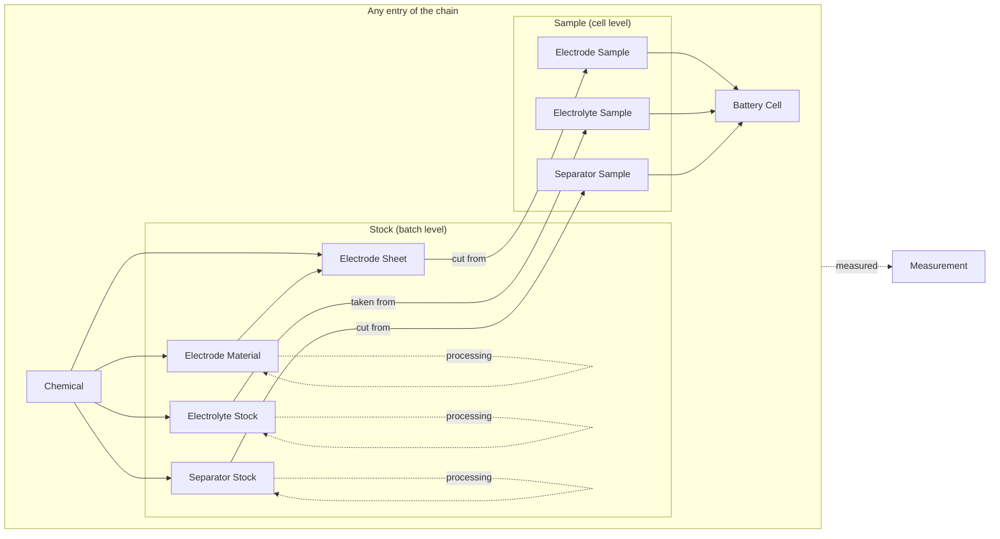
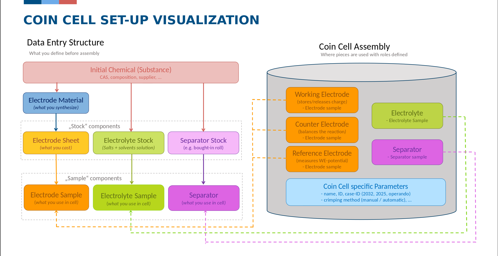
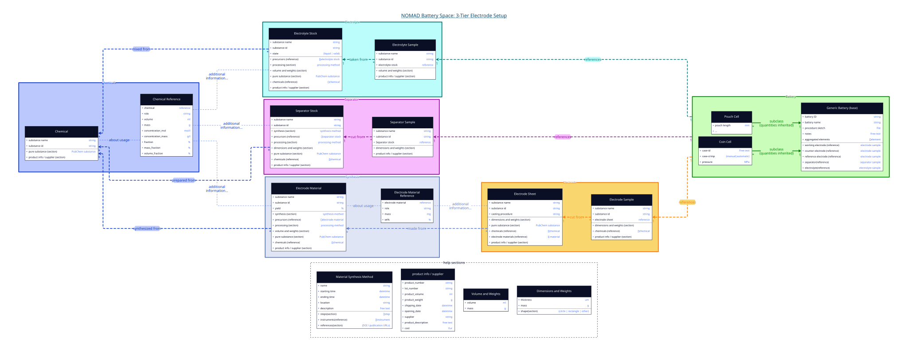

# Data Model Overview

The `nomad-battery-space` plugin documents battery research along the way a cell is
actually built in the lab: from purchased chemicals, via synthesized materials and cast
sheets, to the pieces that go into a cell, and finally to the assembled cell and the
measurements done on it.

Every step is its own ELN entry. Entries are connected by **references**, so each cell can
be traced back to the materials and chemicals it was made from.

## The preparation chain

The model has three levels:

| Level | Entry types | What it represents |
|---|---|---|
| **Chemical** | [Chemical](component_types.md#chemical) | A substance bought from a supplier, the starting point of every chain. |
| **Stock** | [Electrode Material](component_types.md#electrode-material), [Electrode Sheet](component_types.md#electrode-sheet), [Electrolyte Stock](component_types.md#electrolyte-stock), [Separator Stock](component_types.md#separator-stock) | A batch that is synthesized, mixed or bought once and used for many cells. |
| **Sample** | [Electrode Sample](component_types.md#electrode-sample), [Electrolyte Sample](component_types.md#electrolyte-sample), [Separator Sample](component_types.md#separator-sample) | The individual piece that goes into one cell: a punched electrode, a dosed amount of electrolyte, a cut separator. |

On top of these, the [battery cell](cell_assembly_types.md) entries combine the samples
into an assembled cell: either the generic battery sample or a specialized type for a
specific cell format.

[Measurements](measurements.md) store raw data files and can be linked to **any** entry type of
the chain.

??? example "Example: coin cell set-up (click to expand)"
    How the entries are used for a coin cell: on the left the entries you create before
    the assembly, on the right the coin cell entry, which references the samples in their
    roles (working, counter and reference electrode, electrolyte, separator).

    Click the image to enlarge it.

    

## Design principles

- **One entry per physical object.** A stock is created once and referenced by every
  sample cut from it. Properties are stored in one place.
- **Traceability by reference.** Entries point to their inputs. The links are listed in
  [Links between entries](reference_model.md).
- **Derived samples keep their type.** A spray-dried electrode material is again an
  electrode material, linked to its precursor by a
  [processing](reference_model.md#derived-from-another-entry-precursors-and-processing)
  step. This way, intermediates can be measured too.
- **Bought or made.** Every stock and sample can either be made in the lab (with
  chemicals, synthesis or processing) or bought (with
  [product information](../reference/references.md#product-info)).
- **Searchable composition.** The chemical elements of all inputs are collected upwards,
  so a cell can be found by the elements of its electrodes and electrolyte. See
  [Aggregated elements](reference_model.md#aggregated-elements).

## Class diagram

??? info "Class diagram of all entry types (click to expand)"
    All entry types with their fields and the links between them, grouped by chemicals,
    synthesis, electrode, electrolyte, separator and battery. The shared help sections
    are shown at the bottom.

    Click the image to enlarge it.

    

    Not yet shown in the diagram: [precursors and processing](reference_model.md#derived-from-another-entry-precursors-and-processing)
    and [measurements](measurements.md). The pouch cell is planned and not available yet.

## Where to go next

- [Materials and Components](component_types.md): all chemical, stock and sample entry types with their fields.
- [Links between entries](reference_model.md): how entries reference each other, and which values are filled automatically.
- [Battery Cells](cell_assembly_types.md): the generic battery sample and the specialized cell types.
- [Measurements](measurements.md): uploading raw data files and linking them to samples.
