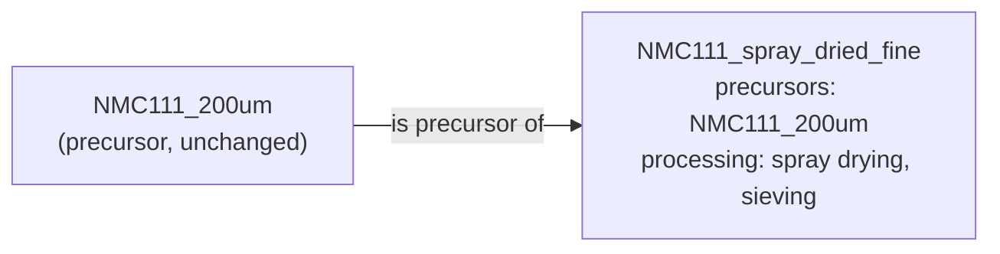

# Links between Entries

Entries in `nomad-battery-space` do not copy data from each other. They **reference** the
entries they were made from. This page lists the kinds of links and the values that are
filled in automatically along them.

## Kinds of links

| Link | From → To | Meaning |
|---|---|---|
| **chemicals** | Electrode Material, Electrode Sheet, Electrolyte Stock, Separator Stock, Electrode Sample → Chemical | These chemicals were used, with role and amount. |
| **electrode materials** | Electrode Sheet → Electrode Material | The sheet contains these materials, with role, mass and wt%. |
| **precursors** + **processing** | Electrode Material → Electrode Material, Electrolyte Stock → Electrolyte Stock, Separator Stock → Separator Stock | This entry was derived from another entry of the same type by processing. |
| **cut / taken from** | Electrode Sample → Electrode Sheet, Electrolyte Sample → Electrolyte Stock, Separator Sample → Separator Stock | This sample is a piece of that stock; the material is unchanged. |
| **cell components** | Battery Sample → Electrode Sample, Electrolyte Sample, Separator Sample | These samples were assembled into the cell. |
| **samples** | Measurement → any sample | This sample was measured. |

In the ELN, a link is set with the reference field: choose an existing entry or create a
new one with the **+** button. In YAML, a reference to an entry in the same upload is
written as:

```yaml
electrolyte_stock: '../upload/archive/mainfile/LP30.archive.yaml#data'
```

## Chemicals with amounts

A `chemicals` entry not only points to a [Chemical](component_types.md#chemical) but also
records how it was used:

| Field | Unit | Description |
|---|---|---|
| **chemical** | | The referenced chemical. |
| **role** | | Solvent, precursor, dopant, binder, electrolyte salt, additive or other. Free text is allowed. |
| **volume** | mL | Volume used. |
| **mass** | g | Mass used. |
| **molar concentration** | mol/L | |
| **mass concentration** | g/L | |
| **fraction** | %, ppm | Mass, volume or mole fraction. |
| **mass fraction (wt%)** | | 0 to 100. |
| **volume fraction (% V/V)** | | |

The name of the chemical is filled in automatically, so the list of chemicals in the ELN
shows readable names.

The same applies to the **electrode materials** of an electrode sheet: each entry points
to an [Electrode Material](component_types.md#electrode-material) and has a role, a mass
(mg) and wt%.

## Derived from another entry: precursors and processing

Some materials are made by modifying an existing material instead of synthesizing a new
one, for example:

- an electrode material that is spray-dried into coarse, medium and fine fractions,
- an electrolyte that is dried or gets an additive,
- a separator that is coated.

The result of such a step is a **new entry of the same type**. The existing material is
its **precursor** (parent), the new entry is the **derived entry** (child).

!!! tip "Processing is always described in the new entry"
    Fill in **precursors** and **processing** in the **new** entry, not in the existing
    one. The processing section answers the question: *how was this entry obtained from
    its precursor?*

    The precursor entry stays as it is. Its own processing section is only used if the
    precursor itself was derived from another entry.



### Workflow in the ELN

1. Make sure the existing material has an entry, e.g. `NMC111_200um`. Do not change it.
2. Create a **new entry of the same type**, e.g. a new Electrode Material
   `NMC111_spray_dried_fine`.
3. In the new entry, add the existing material under **precursors** by selecting it from
   the list. Entering its lab ID also works, with the same limitations as for
   [measurements](measurements.md#which-samples-can-be-measured).
4. In the new entry, describe under **processing** what was done to get from the
   precursor to this material: name, date, steps and instruments.
5. Fill in the properties of the new material as usual, e.g. volume and weights.

If one material is split into several results, e.g. a coarse, a medium and a fine
fraction, create one new entry per result. Each of them has the same precursor and its
own processing.

If a material goes through several steps one after another, create one entry per
intermediate you want to keep, e.g. to measure it. Each entry has the previous one as
precursor. If the intermediates are not needed, one entry with several processing steps
is enough.

```yaml
data:
  m_def: nomad_battery_space.schema_packages.hzb_bs_package.ElectrodeMaterial
  name: NMC111_spray_dried_fine
  precursors:
    - reference: '../upload/archive/mainfile/NMC111_200um.archive.yaml#data'
  processing:
    name: spray drying
    steps:
      - name: spray drying
      - name: sieving, fine fraction
```

Because the result keeps its type, it can be used everywhere the original could: a
spray-dried electrode material can go into an electrode sheet, and each intermediate can
be measured on its own.

The elements of the precursor are taken over automatically, see
[Aggregated elements](#aggregated-elements).

**Processing vs. cut from:** *processing* changes the material (new properties, new
entry of the same type). *Cut from* takes a piece of an unchanged stock to use it in a
cell (from stock level to sample level).

## Values filled in automatically

When an entry is saved, some values are taken from the entries it references. They are
only filled if the field is still empty, unless noted otherwise.

| Value | Source | Applies to |
|---|---|---|
| **aggregated elements** (always recalculated) | All referenced entries, see below | All entry types except Chemical and Measurement |
| **mass**, **volume** | `product_weight` and `product_volume` of the product info | All entries with product info and volume or dimensions |
| **thickness** | Electrode sheet | Electrode Sample |
| **thickness** | Separator stock | Separator Sample |
| **area** | Diameter, or length × width | Circle and rectangle geometry |
| **chemical / material name** | Referenced chemical or electrode material | Chemicals and electrode material lists |
| **pressure** (cleared) | Set to empty for manual crimping | Coin Cell |

### Aggregated elements

Every entry collects the chemical elements of everything it was made from:

- its own elemental composition,
- the referenced chemicals,
- the referenced electrode materials (electrode sheet),
- the precursors,
- the stock it was cut from,
- for a cell: all its electrodes, separator and electrolyte.

The result is stored in **aggregated elements** and in the search index of NOMAD. A cell
with an NMC111 cathode can therefore be found in the *HZB sample search app* by
filtering for Ni, Mn or Co, although these elements were only entered in the electrode
material.

Referenced entries contribute their own aggregated elements, so the elements are passed
on through the whole chain.
