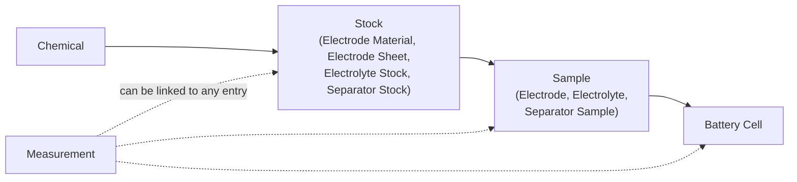

# Workflow

This page describes the basic workflow: where to start and in which order to create
the entries for a battery cell.

## The idea in one sentence

Create one entry per real object (a chemical, a material batch, a sheet, a sample, a
cell) and **link each entry to the entries it was made from**.

## 1. Create a project

All entries live in a **project**. A project is the container for the files, entries
and collaborators of your work, and it controls who can see and edit them.

1. Open **PROJECTS** and select **NEW PROJECT**.
2. Enter a meaningful name, e.g. the name of your research project. This name is shown
   as *Project name* in the *Battery Data Space Search* app.
3. Optionally add co-workers: as **Coauthor** they can view and edit the entries, as
   **Reviewer** they can only view them. Collaborators can also be added later under
   **SETTINGS** → **Collaborators**.
4. Select **CREATE**.

Use one project for one research project or sample series rather than one project per
entry.

!!! note "Working in the old NOMAD GUI?"
    In the old GUI (v1), projects are called **uploads**. Open **PUBLISH** → **Uploads**
    and select **CREATE A NEW UPLOAD**. Entries are then created with
    **CREATE FROM SCHEMA**. Everything else in this tutorial works the same way.

## 2. Create the entries from the bottom up

On the project **Overview** page, select **NEW ENTRY**
and choose the schema. All entry types of this plugin start with **HZB Battery:**.
Enter a file name for the entry and select **CREATE**.

Create them in the order in which the objects were made, so that each entry can link to
entries that already exist:

| Step | Entry type | Links to |
|---|---|---|
| 1 | **Chemical**: purchased substances | – |
| 2 | **Electrode Material**, **Electrolyte Stock**, **Separator Stock** | Chemicals |
| 3 | **Electrode Sheet** | Electrode Materials (and Chemicals) |
| 4 | **Electrode Sample**, **Electrolyte Sample**, **Separator Sample** | The sheet or stock they were cut or taken from |
| 5 | **Battery cell**, e.g. Coin Cell | Electrode, Electrolyte and Separator Samples |
| 6 | **Measurement** | Any of the entries above |

You do not need every step for every cell. A bought electrode sheet, for example, can be
created directly without electrode materials, and a bought electrolyte without chemicals.

!!! tip "Reuse existing entries"
    Chemicals, stocks and sheets are usually used for many cells. Create them once and
    link to them again and again. Check the *Battery Data Space Search* app first,
    maybe the entry already exists.

## 3. Fill in each entry

For every entry:

1. Enter a **name**. The **lab ID** is filled in automatically when the entry is
   created (see below), so usually you do not need to enter it.
2. Set the **links** to the entries it was made from (see the table above). Select the
   entry from the list in the reference field.
3. Fill in the fields you know. Everything else can be added later.
4. **Save** the entry. Some values are filled in automatically when saving, e.g. the
   elements of all linked entries or the thickness taken over from the sheet or stock.
   See [Values filled in automatically](../explanation/reference_model.md#values-filled-in-automatically).

!!! info "Lab ID"
    When the entry is created, the lab ID is generated from your institute, your
    initials, the date and the name of the entry, e.g.
    `HZB_JaDo_20261123_NMC111-200um`. You can overwrite
    it with your own ID, e.g. the ID written on the vial or the cell. Other entries can
    reference an entry by its lab ID, so keep it unique.

!!! tip "Material processed further?"
    If you modify an existing material, e.g. by spray drying, drying or coating, do not
    change the existing entry. Create a **new entry of the same type** and add the
    existing one as its precursor. The processing is described in the new entry. See
    [Precursors and processing](../explanation/reference_model.md#derived-from-another-entry-precursors-and-processing).

## 4. Add measurements

Create a **Measurement** entry in the same project, upload the raw data files (any format)
and link the measured samples. A measurement can be linked to any entry of the chain,
not only to a cell. See [Measurements](../explanation/measurements.md).

## 5. Find your entries again

Use the **Battery Data Space Search** app to find entries, e.g. by entry type, lab ID,
project name or chemical elements. Because the elements are passed on along the links,
a cell can also be found by the elements of its electrode materials.

## Where to go next

- [Materials and Components](../explanation/component_types.md): all fields of each entry type.
- [Links between Entries](../explanation/reference_model.md): how the entries are connected.
- [Battery Cells](../explanation/cell_assembly_types.md): the cell types.
